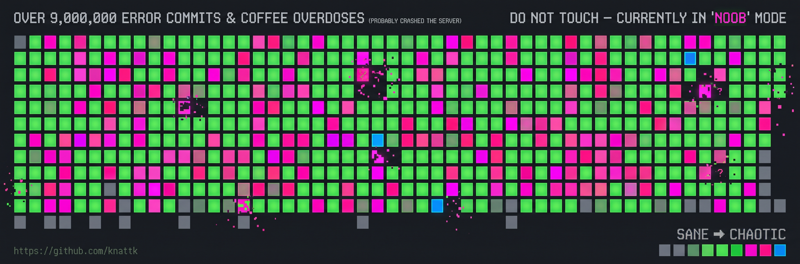

<!-- หัวข้อแบนเนอร์กวนๆ -->
<table width="100%" border="0" cellpadding="0" cellspacing="0" style="background-color: #222830; font-family: -apple-system, BlinkMacSystemFont, 'Segoe UI', Helvetica, Arial, sans-serif; padding: 20px; border-radius: 6px;">
  <tr>
    <td style="padding-bottom: 15px;">
      

        OVER 9,000,000 ERROR COMMITS & COFFEE OVERDOSES (PROBABLY CRASHED THE SERVER)
        DO NOT TOUCH — CURRENTLY IN 'NOOB' MODE
      

    </td>
  </tr>
  <tr>
    <td>
      <!-- จุดเริ่มต้นของ Grid -->
      

        <table border="0" cellpadding="0" cellspacing="3" style="border-collapse: separate; background-color: #222830;">
          <!-- สร้างแถวและช่องสี่เหลี่ยม HTML (ตัวอย่างแถวที่ 1-7) -->
          <!-- แถวที่ 1 -->
          <tr>
            <td width="10" height="10" style="background-color: #2d333b; border-radius: 2px;"></td>
            <td width="10" height="10" style="background-color: #39d353; border-radius: 2px;"></td>
            <td width="10" height="10" style="background-color: #ff007f; border-radius: 2px;"></td>
            <td width="10" height="10" style="background-color: #0e4429; border-radius: 2px;"></td>
            <td width="10" height="10" style="background-color: #39d353; border-radius: 2px;"></td>
            <td width="10" height="10" style="background-color: #ff007f; border-radius: 2px;"></td>
            <td width="10" height="10" style="background-color: #26a641; border-radius: 2px;"></td>
            <td width="10" height="10" style="background-color: #0e4429; border-radius: 2px;"></td>
            <!-- สามารถทำซ้ำ <td ...> เพื่อขยายช่องให้เต็มหน้าจอได้ตามต้องการ -->
          </tr>
          <!-- แถวที่ 2 -->
          <tr>
            <td width="10" height="10" style="background-color: #39d353; border-radius: 2px;"></td>
            <td width="10" height="10" style="background-color: #26a641; border-radius: 2px;"></td>
            <td width="10" height="10" style="background-color: #2d333b; border-radius: 2px;"></td>
            <td width="10" height="10" style="background-color: #39d353; border-radius: 2px;"></td>
            <td width="10" height="10" style="background-color: #ff007f; border-radius: 2px;"></td>
            <td width="10" height="10" style="background-color: #0e4429; border-radius: 2px;"></td>
            <td width="10" height="10" style="background-color: #39d353; border-radius: 2px;"></td>
            <td width="10" height="10" style="background-color: #ff007f; border-radius: 2px;"></td>
          </tr>
          <!-- เพิ่มแถว 3, 4, 5, 6, 7 ให้ครบ 7 วันในหนึ่งสัปดาห์ -->
        </table>
      

    </td>
  </tr>
  <!-- ลิงก์และ Legend ด้านล่าง -->
  <tr>
    <td style="padding-top: 15px;">
      

        <a href="https://github.com/knattk" style="color: #539bf5; text-decoration: none;">https://github.com/knattk</a>
        

          SANE ➔ CHAOTIC
          
          
          
          
          
          
        

      

    </td>
  </tr>
</table>
